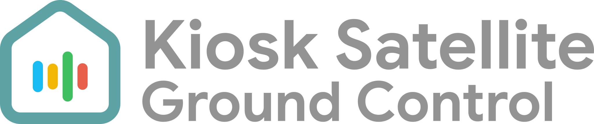
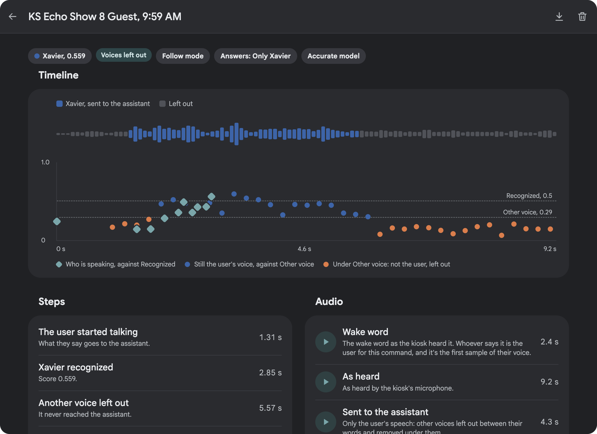

<h1 align="center">
  <picture>
    <source media="(prefers-color-scheme: dark)" srcset="assets/banners/ks_banner_dark.svg" />
    <source media="(prefers-color-scheme: light)" srcset="assets/banners/ks_banner_light.svg" />
    
  </picture>
</h1>

<p align="center">

<a href="https://github.com/jxlarrea?tab=packages&repo_name=kiosk-satellite-ground-control"></a>
<a href="CHANGELOG.md"></a>
<a href="https://github.com/jxlarrea/kiosk-satellite-ground-control/actions/workflows/images.yml"></a>
</p>

<p align="center">
<a href="https://my.home-assistant.io/redirect/supervisor_add_addon_repository/?repository_url=https%3A%2F%2Fgithub.com%2Fjxlarrea%2Fkiosk-satellite-ground-control"></a>
<a href="https://github.com/users/jxlarrea/packages/container/package/kiosk-satellite-ground-control"></a>
<a href="docs/installation.md#nvidia-gpu"></a>
</p>

<p align="center">
<a href="https://buymeacoffee.com/jxlarrea"></a>
</p>

Ground Control is a companion service for [Kiosk Satellite](https://github.com/jxlarrea/kiosk-satellite). It runs on a computer or server in your home and handles the voice and vision processing that kiosks don't have the computing power for. Install it as a Home Assistant app or run it in Docker on a CPU or an NVIDIA GPU.

Kiosk Satellite Ground Control currently has two components. **Voice Match** handles speaker voice recognition, trimming, wake word alignment and isolation. **Vision Match** handles face detection, hand gestures and face recognition.

<p align="center">
  <a href="assets/screenshots/people.png"></a>
</p>

## Voice Match

Voice Match is Ground Control's first set of features. It identifies who is speaking and keeps only their voice in the command.

### Recognition

Recognition identifies the speaker from the voiceprints of the people enrolled. On the People page, enroll each person once on every device model they talk to. After that, the speaker is known about a second into each command.

Each kiosk gets a Speaker sensor in Home Assistant. You can also set a kiosk to answer only the people you choose. To pass the speaker to an LLM conversation agent, paste the template from **Settings > General > Conversation agents** into the agent's instructions. "My calendar" or "my list" then means the speaker's.

<p align="center">
  <a href="assets/screenshots/timeline.png"></a>  
</p>

### Trimming

Turn on **Enable Trimming** in Kiosk Satellite and the kiosk sends all of its microphone audio. Ground Control sends back only the speech of the person who said the wake word. A TV or another person talking before, between and after their words is cut out. Long pauses are shortened. The command ends once the user stops talking, no matter what the TV is doing. "Turn on the (TV talking) kitchen lights" reaches the assistant as "turn on the kitchen lights".

Trimming doesn't simply end the command when someone else starts talking because that would lose whatever the user says after the other voice. It cuts the other voice out and keeps the user's words on both sides of it.

<video src="assets/videos/voice-match-trimming.mp4" controls width="100%"></video>

https://github.com/user-attachments/assets/985faf93-9b86-48ce-bbda-41d91d0a1b49

### Wake Word Aligner

If **Talk right after the wake word** is on in Kiosk Satellite, the command's audio starts the moment the wake word is recognized. That happens before the word is over. The end of the wake word then reaches the assistant in front of the command. For example, the "xa" of "Alexa" turns "what time is it" into "So what time is it".

With the Wake Word Aligner, the command starts where the wake word ends. It works with any wake word and any wake word engine, since only the wake word's text is needed. It needs Trimming and is on by default. See [Wake Word Aligner](docs/voice-match.md#wake-word-aligner).

### Isolation

Trimming leaves other voices out between the user's words. Isolation uses the user's voiceprint to also remove other voices where they overlap the user's. Turn it on under **Settings > Voice Match > Isolation**. It needs the Accurate speaker model. To turn it off for one kiosk, use **Enable Isolation** in Kiosk Satellite.

Isolation processes a whole turn at once, so it adds a delay after the user stops talking. The delay is about a tenth of a second on an NVIDIA GPU (see [Performance Benchmarks](#performance-benchmarks)).

<video src="assets/videos/voice-match-isolation.mp4" controls width="100%"></video>

https://github.com/user-attachments/assets/4485f1fc-af2a-4d17-a7de-2b0b3ebe7f3f

## Vision Match

Vision Match runs Kiosk Satellite's camera features on Ground Control. The camera and motion detection stay on the kiosk. When something moves, the kiosk sends a camera frame to Ground Control and gets back what is in it. A kiosk that is too slow for these models or can't run them, like an Echo Show 5 or an Android 7 tablet, gets the same features as a fast one. Turn it on for each kiosk in Kiosk Satellite under **Settings > Ground Control > Vision Match**.

### Face Detection

The faces looking at the kiosk are found on Ground Control, so a face can dismiss or postpone the screensaver. A face looking at the screen is told apart from a head turned away. On kiosk frames from 1 to 3 m, a head turned away passed as a face looking at the screen in 10% of frames. With the models on the kiosk it was 82%.

### Hand Gestures

For Show fingers gestures, the fingers held up on a raised hand are counted on Ground Control. On the same frames the finger count was right in 91 to 96% of frames, compared to 28% with the models on the kiosk. **Hand sensitivity** under **Settings > Vision Match** sets the smallest hand that counts, so a hand cut off at the edge of the frame doesn't trigger a gesture.

### Face Recognition

Enroll each person's face once on the People page with a guided capture of about half a minute through a kiosk's camera. After that, the kiosk's **Face** sensor in Home Assistant shows who is at the kiosk and its **People in view** sensor lists everyone recognized. With Kiosk Satellite's settings you can then:

- Dismiss the screensaver only for the people you choose.
- Skip the kiosk PIN or turn Lockdown Mode off for chosen people.
- Accept a voice that is close to someone's voiceprint when their face is at the kiosk.

Cards on the kiosk screen show who was recognized and what happened because of it. A Face event in Home Assistant fires when someone arrives at the kiosk and when they leave. Ground Control keeps only small pictures of each enrolled face.

## Performance Benchmarks

<details>
<summary><strong>Voice Match</strong></summary>

These tables show how much latency each feature adds to a 5-second command.

#### CPU

| | Raspberry Pi 4 | Intel N100 | Intel N100 | i9-13900H | MacBook Pro M5 |
|---|---|---|---|---|---|
| Speaker model | Light | Light | Accurate | Accurate | Accurate |
| Recognition | 0.11 s | 0.02 s | 0.27 s | 0.04 s | 0.02 s |
| Trimming | <0.01 s | <0.01 s | 0.14 s | 0.02 s | 0.01 s |
| Wake Word Aligner | 0.05 s | 0.02 s | 0.02 s | <0.01 s | 0.01 s |
| Isolation | Too slow | Needs Accurate | 5.71 s | 1.21 s | 0.78 s |
| **All features** | **<0.01 s** (no Isolation) | **<0.01 s** (no Isolation) | **5.85 s** | **1.23 s** | **0.79 s** |

These numbers use the CPU image with Ground Control's default threads. That is 2 threads on the Pi and the N100 and 4 on the others. The MacBook Pro runs it in Docker Desktop.

#### NVIDIA GPU (CUDA)

| | RTX 3050 | RTX 4000 SFF Ada | GB10 |
|---|---|---|---|
| Speaker model | Accurate | Accurate | Accurate |
| Recognition | 0.02 s | 0.01 s | 0.01 s |
| Trimming | 0.01 s | <0.01 s | <0.01 s |
| Wake Word Aligner | 0.01 s | <0.01 s | 0.01 s |
| Isolation | 0.23 s | 0.11 s | 0.11 s |
| **All features** | **0.24 s** | **0.12 s** | **0.12 s** |

These numbers use the CUDA image with CUDA 12 on the RTX 3050 and the RTX 4000 and CUDA 13 on the GB10. Isolation's time depends on the GPU's compute, so a GPU with about half the compute takes about twice as long. `KEEP_GPU_MEMORY` is on for the GB10. It keeps Isolation's GPU memory between commands (see [GPU Memory](docs/installation.md#gpu-memory)). Without it, Isolation takes 0.16 s there. The Wake Word Aligner runs on the machine's CPU even in the CUDA image.

#### GPU Memory

This table shows how much GPU memory the CUDA image uses with the Accurate speaker model. It was measured on the RTX 4000 SFF Ada and the GB10.

| | amd64 image (CUDA 12) | arm64 image (CUDA 13) |
|---|---|---|
| Kept, Recognition and Trimming | 0.6 GB | 0.7 GB |
| Kept, with Isolation | 0.8 GB | 0.9 GB |
| Most during a command | 0.9 GB | 0.9 GB |
| Most during a command, with Isolation | 2.3 GB | 2.4 GB |

Ground Control keeps the first two amounts for as long as it runs. The memory a command adds is freed once the command is done. See [GPU Memory](docs/installation.md#gpu-memory).

#### How It Is Measured

Each test sends a 5 s command between stretches of TV through Ground Control's own code in real time just like a kiosk does.

- **Recognition** is the time to check a voice. It runs while the user talks and holds nothing up. If the wake word is clear, the speaker is known before the user says anything.
- **Trimming** is the time to decide the command is over once the user stops. The command ends there no matter what the TV is doing.
- **Wake Word Aligner** is the time to find where the wake word ends. It runs once about a second into the command while the command's first audio is still held for the voice check. It adds nothing at the end of the command.
- **Isolation** runs once the command ends. On a CPU it uses a version of the model made for the CPU (LSTMs in 8 bits). That version is twice as fast and gives nearly identical results.
- **All features** is the delay at the end of each command from Trimming and then Isolation.
- On an N100, Ground Control uses the Light model by default. Accurate keeps up with one kiosk at a time, but Isolation takes about 6 s with it.
- On a Pi 4, use the Light model. Accurate needs more CPU than a Pi 4 has, so everything runs late. Isolation needs Accurate and takes about 25 s there.

The Accurate model makes the fewest mix-ups between people and with TV voices. The Light model uses about a third of the CPU. With Light, a TV voice cutting in ends the command about a second later. Ground Control picks Accurate on an NVIDIA GPU, an Apple M-series chip or an x86 CPU with more than 4 cores. It picks Light on other ARM CPUs and smaller x86 CPUs like the N100. You can change it under **Settings > Voice Match** without re-enrolling anyone.

On amd64, the CUDA image works with NVIDIA GPUs from the GTX 10 series (Pascal) to the RTX 50 series (Blackwell). On arm64, it works with the GB10 and other Blackwell boards. It needs 1 GB of free GPU memory or 2.5 GB with Isolation. Vision Match needs about 0.5 GB more.

</details>

<details>
<summary><strong>Vision Match</strong></summary>

These tables show how long Ground Control takes for one camera look.

#### CPU

| | Raspberry Pi 4 | Intel N100 | Intel N100 | i9-13900H | MacBook Pro M5 |
|---|---|---|---|---|---|
| Vision models | Light | Light, Accurate recognition | Accurate | Light, Accurate recognition | Light, Accurate recognition |
| Face Detection | 386 ms | 81 ms | 319 ms | 18 ms | 18 ms |
| Hand Gestures | 455 ms | 94 ms | 1,830 ms | 23 ms | 20 ms |
| Face Recognition | 78 ms | 173 ms | 173 ms | 35 ms | 49 ms |
| **All features** | **913 ms** | **346 ms** | **2,320 ms** | **75 ms** | **85 ms** |
| Looks a second | 1.1 | 2.9 | 0.4 | 13.4 | 11.7 |

These numbers use the CPU image with Ground Control's default threads. That is 2 threads on the Pi and the N100 and 4 on the others. The MacBook Pro runs it in Docker Desktop. Each column uses that machine's default models except the second N100 column, which has every feature on Accurate. Accurate Hand Gestures is what makes it slow: 1.8 s a look on the N100, 352 ms on the i9 and 256 ms on the MacBook Pro.

#### NVIDIA GPU (CUDA)

| | RTX 3050 | RTX 4000 SFF Ada | GB10 |
|---|---|---|---|
| Vision models | Accurate | Accurate | Accurate |
| Face Detection | 11 ms | 6 ms | 9 ms |
| Hand Gestures | 23 ms | 12 ms | 13 ms |
| Face Recognition | 5 ms | 3 ms | 5 ms |
| **All features** | **38 ms** | **20 ms** | **24 ms** |
| Looks a second | 26.2 | 49.5 | 41.5 |

These numbers use the CUDA image with CUDA 12 on the RTX 3050 and the RTX 4000 and CUDA 13 on the GB10. The vision models' time depends on the GPU's compute, so a GPU with about half the compute takes about twice as long for them. Reading the JPEG and the rest of a look's work run on the machine's CPU even in the CUDA image, so that part doesn't change with the GPU.

#### GPU Memory

This table shows how much GPU memory the CUDA image uses with every vision model on Accurate. It was measured on the RTX 4000 SFF Ada and the GB10.

| | amd64 image (CUDA 12) | arm64 image (CUDA 13) |
|---|---|---|
| Kept | 0.7 GB | 0.7 GB |
| Most during a look | 0.7 GB | 0.7 GB |

The vision models load when the first kiosk asks for a look. Ground Control then keeps their memory for as long as it runs. A look adds nothing to it. Vision Match shares the CUDA runtime with Voice Match, so together they need about 0.5 GB more than Voice Match's numbers above.

#### How It Is Measured

Each test sends 64 frames from an Echo Show 5's camera through Ground Control's own code just like a kiosk does. They are 640x480 JPEGs, the size Kiosk Satellite sends, and each one has a face looking at the camera and a raised hand.

- **Face Detection** is a look for faces alone. **Hand Gestures** is a look for hands alone. Both include reading the JPEG.
- **Face Recognition** is the time to recognize one face once it is found. Once someone is recognized, their face is checked again only every 2 seconds. A face nobody enrolled is checked again once a second.
- **All features** is one look with Face Detection, Face Recognition and Hand Gestures. That is the longest a look takes.
- **Looks a second** is how many of those looks Ground Control keeps up with. A kiosk sends one frame at a time and only after something moves, so several kiosks can share them. Since Face Recognition runs on at most one look a second, the looks between get closer to the time of Face Detection and Hand Gestures alone.
- On a Pi 4, Face Detection dismisses the screensaver about a second after a face looks at the kiosk. Hand Gestures feel slow there because a gesture needs more than one look.

Each feature has its own model under **Settings > Vision Match**:

- **Face Detection:** both models found every face looking at the kiosk on the test set and let the same turned heads through. Accurate takes about 3 times as long, so Light is the default on a CPU.
- **Hand Gestures:** Accurate gets the finger count right more often at 3 m and in dim light, 96% of frames compared to 68%. It runs on every look, so Light is the default on a CPU.
- **Face Recognition:** Accurate recognizes small faces in dim light more often, 93% compared to 71%. It runs at most once a second, so Accurate is the default on x86 CPUs and Apple M-series chips. A Raspberry Pi and other ARM CPUs use Light.

On an NVIDIA GPU every feature uses Accurate. Changing the Face Recognition model doesn't require enrolling any faces again.

</details>

## Install

Ground Control runs as a Home Assistant app or as a standalone Docker container. See [Installation](docs/installation.md) for the details and every option.

### Home Assistant App

The simplest way to run Ground Control is as a Home Assistant app. It runs on the CPU of the machine running Home Assistant.

[](https://my.home-assistant.io/redirect/supervisor_add_addon_repository/?repository_url=https%3A%2F%2Fgithub.com%2Fjxlarrea%2Fkiosk-satellite-ground-control)

1. Select the button above or add `https://github.com/jxlarrea/kiosk-satellite-ground-control` under **Settings > Apps > App store > Repositories**.
2. Install **Kiosk Satellite Ground Control** and start it.
3. Open **Ground Control** in the sidebar.

The app needs Home Assistant OS or a Supervised install. For Isolation on an NVIDIA GPU, run the Docker container on a machine with the GPU instead.

### Standalone Docker Container

Use the Docker container to run Ground Control on a machine other than Home Assistant's or on an NVIDIA GPU.

**Docker Compose:** [compose.yaml](compose.yaml) for the CPU and [compose.cuda.yaml](compose.cuda.yaml) for an NVIDIA GPU. Set `HA_URL` in the file, then run `docker compose up -d` (or `docker compose -f compose.cuda.yaml up -d`). Both use the host network, so the service is discovered automatically on the same network.

**Docker, CPU:**

```bash
docker run -d --name ground-control -p 10900:10900 \
  -e HA_URL=http://homeassistant.local:8123 \
  -v ground-control:/data ghcr.io/jxlarrea/kiosk-satellite-ground-control
```

**Docker, NVIDIA GPU:**

```bash
docker run -d --name ground-control --gpus all -p 10900:10900 \
  -e HA_URL=http://homeassistant.local:8123 \
  -v ground-control:/data ghcr.io/jxlarrea/kiosk-satellite-ground-control:cuda
```

If you use `-p 10900:10900` instead of the host network, the service isn't discovered automatically. Enter this machine's address in each kiosk.

**Mac with Apple silicon:** run the CPU command above in Docker Desktop or OrbStack. Docker on a Mac can't use the Mac's GPU, but every feature including Isolation runs on the CPU of an M-series chip. Ground Control on a Mac isn't discovered automatically, so enter the Mac's address in each kiosk. See [Mac with Apple Silicon](docs/installation.md#mac-with-apple-silicon).

The GPU needs to be from the GTX 10 series or newer. The host needs an NVIDIA driver from the 570 series or newer (580 or newer on arm64) and the [NVIDIA Container Toolkit](https://docs.nvidia.com/datacenter/cloud-native/container-toolkit/latest/install-guide.html). If Docker runs inside an LXC container (Proxmox), set `nvidia-ctk config --set nvidia-container-cli.no-cgroups --in-place` and also pass the devices. Otherwise `nvidia-smi` fails with "Failed to initialize NVML: Unknown Error":

```bash
  --device /dev/nvidia0 --device /dev/nvidiactl --device /dev/nvidia-uvm --device /dev/nvidia-uvm-tools
```

`HA_URL` is your Home Assistant address. Kiosks sign in with the Home Assistant token they already have. Ground Control checks that token against Home Assistant. You also log in through `HA_URL` in your browser, so use an address your browser can open. Avoid one that only works inside Docker. See [Installation](docs/installation.md#environment-variables) for every setting.

## Getting started

1. **Open Ground Control.** If you installed the Home Assistant app, it's in the sidebar. If you run the container, open port 10900 and select **Log in with Home Assistant**.
2. **Connect your kiosks.** Ground Control is discovered automatically on the same network. For a kiosk on another network, enter the address from **Settings > General > Kiosks** in Kiosk Satellite. Approve each new kiosk on the Kiosks page. Ground Control only accepts kiosks running Kiosk Satellite.
3. **Enroll people.** Add each person on the People page, then enroll their voice on a kiosk of every kind they talk to.
4. **Turn on what you want.** In Kiosk Satellite, under **Settings > Ground Control > Voice Match**, choose who each kiosk answers and turn on **Enable Trimming** and **Enable Isolation**. Turn on Isolation in Ground Control's settings too.

## Documentation

- [Getting started](docs/getting-started.md): the steps from installing Ground Control to recognizing who is talking at a kiosk.
- [Installation](docs/installation.md): the Home Assistant app, Docker on a CPU or an NVIDIA GPU, options and updating.
- [Kiosks](docs/kiosks.md): connecting and approving kiosks, kiosks on another network and each kiosk's page.
- [People](docs/people.md): adding people, enrollment and personal commands.
- [Voice Match](docs/voice-match.md): Recognition, Trimming, the Wake Word Aligner, Isolation and the speaker models.
- [Backup and moving](docs/backup.md): backing up the data and moving it to another machine for the app and Docker.
- [Sessions](docs/sessions.md): what each voice command did, its audio and how to download it for an issue.
- [Settings](docs/settings.md): every setting and the template for LLM conversation agents.
- [Logs and issues](docs/logs.md): reading the log and reporting an issue.

## Thank you for your support

Thank you to everyone who supports my work through [Buy Me a Coffee](https://buymeacoffee.com/jxlarrea). I test everything on real hardware, which means buying devices to reproduce issues and check changes across different manufacturers and Android flavors. Your contributions help cover those purchases and make that testing possible.

## License and credits

Free for personal, non-commercial use under [CC BY-NC-ND 4.0](LICENSE). Commercial use and redistribution of modified builds are not permitted.

Each model's license is in `models/` in a file named after the model. ReDimNet2 by Palabra.ai and Silero VAD by the Silero Team keep their MIT licenses.

The Voice Isolator models and the Wake Word Aligner model are not under CC BY-NC-ND 4.0. They have their own licenses: the [Voice Isolator license](models/voice_isolator.LICENSE.md) and the [Wake Word Aligner license](models/wake_word_aligner.LICENSE.md). They may only be used as part of Ground Control with Kiosk Satellite. They may not be redistributed alone or with other software. They may not be converted, modified or used to train other models.

The Docker images and the Home Assistant app include [espeak-ng](https://github.com/espeak-ng/espeak-ng) (GPL 3.0). It is a separate program that Ground Control runs to get the pronunciation of a wake word.
