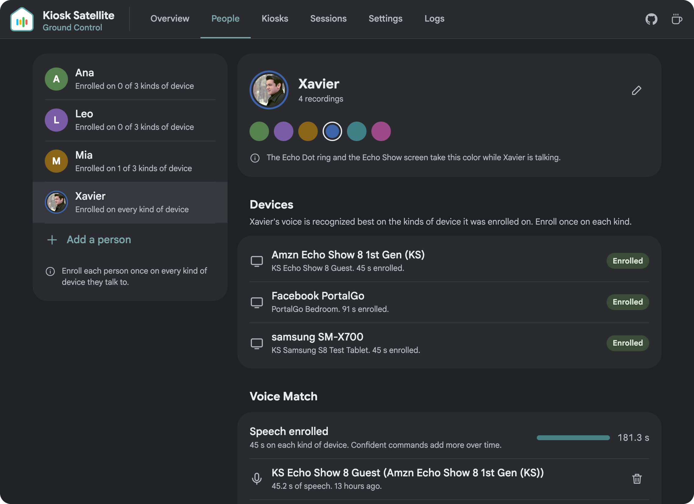

<h1 align="center">
  <picture>
    <source media="(prefers-color-scheme: dark)" srcset="assets/banners/ks_banner_dark.svg" />
    <source media="(prefers-color-scheme: light)" srcset="assets/banners/ks_banner_light.svg" />
    
  </picture>
</h1>

<p align="center">

<a href="https://github.com/jxlarrea?tab=packages&repo_name=kiosk-satellite-ground-control"></a>
<a href="CHANGELOG.md"></a>
<a href="https://github.com/jxlarrea/kiosk-satellite-ground-control/actions/workflows/images.yml"></a>
</p>

<p align="center">
<a href="https://my.home-assistant.io/redirect/supervisor_add_addon_repository/?repository_url=https%3A%2F%2Fgithub.com%2Fjxlarrea%2Fkiosk-satellite-ground-control"></a>
<a href="https://github.com/users/jxlarrea/packages/container/package/kiosk-satellite-ground-control"></a>
<a href="docs/installation.md#nvidia-gpu"></a>
</p>

<p align="center">
<a href="https://buymeacoffee.com/jxlarrea"></a>
</p>

Ground Control is a companion service for [Kiosk Satellite](https://github.com/jxlarrea/kiosk-satellite). It runs on a computer or server in your home and handles the voice and vision processing that kiosks don't have the computing power for. Install it as a Home Assistant app, or run it in Docker on a CPU or an NVIDIA GPU.

Kiosk Satellite Ground Control currently has two components: **Voice Match** which does speaker voice recognition, trimming, wake word alignment and isolation. **Vision Match** which does facial recognition (coming soon).

<p align="center">
  <a href="assets/screenshots/people.png"></a>
</p>

## Voice Match

Voice Match is Ground Control's first set of features: who is speaking, and only their voice in the command.

### Recognition

Who is speaking, from the voiceprints of the people enrolled. Enroll each person once on every device model they talk to, from the People page. Recognition then takes about a second into each command.

Each kiosk gets a Speaker sensor in Home Assistant, and a kiosk can answer only the people you choose. An LLM conversation agent can tell who is speaking too: paste the template from **Settings > General > Conversation agents** into the agent's instructions, and "my calendar" or "my list" means the speaker's.

<p align="center">
  <a href="assets/screenshots/timeline.png"></a>  
</p>

### Trimming

Turn on **Enable Trimming** in Kiosk Satellite and the kiosk sends everything its microphone hears. Ground Control sends back only the speech of the person who said the wake word. A TV or another person before, between and after their words is cut out, long pauses are shortened and the command ends once the user stops talking, whatever the TV does. "Turn on the (TV talking) kitchen lights" reaches the assistant as "turn on the kitchen lights".

Trimming doesn't just end the command when someone else starts talking, which would lose whatever the user says after the other voice. It cuts the other voice out and keeps the user's words on both sides of it.

<video src="assets/videos/voice-match-trimming.mp4" controls width="100%"></video>

https://github.com/user-attachments/assets/985faf93-9b86-48ce-bbda-41d91d0a1b49

### Wake Word Aligner

With **Talk right after the wake word** on in Kiosk Satellite, the command's audio starts the moment the wake word is recognized, before the word is over. Its end then reaches the assistant in front of the command: the "xa" of "Alexa" turns "what time is it" into "So what time is it".

With the Wake Word Aligner, the command starts where the wake word ends. It works with any wake word and any wake word engine, since only the wake word's text is needed. It needs Trimming and is on by default. See [Wake Word Aligner](docs/voice-match.md#wake-word-aligner).

### Isolation

Trimming leaves other voices out between the user's words. Isolation also removes them where they talk over the user, using the user's voiceprint. Turn it on under **Settings > Voice Match > Isolation**. It needs the Accurate speaker model. Each kiosk can turn it off with **Enable Isolation** in Kiosk Satellite.

Isolation works on a whole turn at once, so each command waits for it once the user stops talking: about a tenth of a second on an NVIDIA GPU (see [Performance Benchmarks](#performance-benchmarks)).

<video src="assets/videos/voice-match-isolation.mp4" controls width="100%"></video>

https://github.com/user-attachments/assets/4485f1fc-af2a-4d17-a7de-2b0b3ebe7f3f

## Vision Match

Coming soon.

## Performance Benchmarks

How much latency each feature adds to a 5-second command.

### CPU

| | Raspberry Pi 4 | Intel N100 | Intel N100 | i9-13900H | MacBook Pro M5 |
|---|---|---|---|---|---|
| Speaker model | Light | Light | Accurate | Accurate | Accurate |
| Recognition | 0.11 s | 0.02 s | 0.27 s | 0.04 s | 0.02 s |
| Trimming | <0.01 s | <0.01 s | 0.14 s | 0.02 s | 0.01 s |
| Wake Word Aligner | 0.05 s | 0.02 s | 0.02 s | <0.01 s | 0.01 s |
| Isolation | Too slow | Needs Accurate | 5.71 s | 1.21 s | 0.78 s |
| **All features** | **<0.01 s** (no Isolation) | **<0.01 s** (no Isolation) | **5.85 s** | **1.23 s** | **0.79 s** |

The CPU image with Ground Control's default threads: 2 on the Pi and the N100, 4 on the others. The MacBook Pro runs it in Docker Desktop.

### NVIDIA GPU (CUDA)

| | RTX 3050 | RTX 4000 SFF Ada | GB10 |
|---|---|---|---|
| Speaker model | Accurate | Accurate | Accurate |
| Recognition | 0.02 s | 0.01 s | 0.01 s |
| Trimming | 0.01 s | <0.01 s | <0.01 s |
| Wake Word Aligner | 0.01 s | <0.01 s | 0.01 s |
| Isolation | 0.23 s | 0.11 s | 0.11 s |
| **All features** | **0.24 s** | **0.12 s** | **0.12 s** |

The CUDA image: CUDA 12 on the RTX 3050 and the RTX 4000, CUDA 13 on the GB10. Isolation's time grows with the work it does, so a GPU with about half the compute takes about twice as long. The GB10 runs with `KEEP_GPU_MEMORY` on, which keeps Isolation's GPU memory between commands (see [GPU Memory](docs/installation.md#gpu-memory)). Without it, Isolation takes 0.16 s there. The Wake Word Aligner runs on the machine's CPU, also in the CUDA image.

### GPU Memory

How much GPU memory the CUDA image uses with the Accurate speaker model, measured on the RTX 4000 SFF Ada and the GB10.

| | amd64 image (CUDA 12) | arm64 image (CUDA 13) |
|---|---|---|
| Kept, Recognition and Trimming | 0.6 GB | 0.7 GB |
| Kept, with Isolation | 0.8 GB | 0.9 GB |
| Most during a command | 0.9 GB | 0.9 GB |
| Most during a command, with Isolation | 2.3 GB | 2.4 GB |

Ground Control keeps the first two amounts for as long as it runs. What a command adds is free again once it is done. See [GPU Memory](docs/installation.md#gpu-memory).

### How It Is Measured

A 5 s command between stretches of TV, sent through Ground Control's own code in real time the way a kiosk sends it.

- **Recognition** is the time to check a voice. It runs while the user talks and holds nothing up. With a clear wake word, the speaker is known before the user says anything.
- **Trimming** is the time to decide the command is over once the user stops. Whatever the TV does, the command ends there.
- **Wake Word Aligner** is the time to find where the wake word ends. It runs once, about a second into the command, while the command's first audio is still held for its voice check. It holds nothing up at the end of the command.
- **Isolation** runs once the command ends. On a CPU it uses a version of the model made for the CPU (LSTMs in 8 bits), twice as fast and nearly identical.
- **All features** is what reaches the end of each command: Trimming, then Isolation.
- On an N100, Ground Control starts on the Light model. Accurate keeps up with one kiosk at a time, but Isolation takes about 6 s with it.
- On a Pi 4, use the Light model. Accurate uses more CPU than a Pi 4 has, so everything runs late, and Isolation (which needs Accurate) takes about 25 s there.

The Accurate model makes the fewest mix-ups between people and with TV voices. The Light model uses about a third of the CPU, and a TV voice cutting in ends the command about a second later. Ground Control picks Accurate on an NVIDIA GPU, an Apple M-series chip or an x86 CPU with more than 4 cores, and Light on other ARM CPUs and smaller x86 CPUs like the N100. **Settings > Voice Match** changes it without needing to re-enroll users.

The CUDA image works with NVIDIA GPUs on amd64 from the GTX 10 series (Pascal) to the RTX 50 series (Blackwell), and on arm64 with the GB10 and other Blackwell boards. It needs 1 GB of free GPU memory, or 2.5 GB with Isolation.

## Install

Ground Control runs as a Home Assistant app or as a standalone Docker container. See [Installation](docs/installation.md) for the details and every option.

### Home Assistant App

The simplest way to run Ground Control is as a Home Assistant app, on the CPU of the machine running Home Assistant:

[](https://my.home-assistant.io/redirect/supervisor_add_addon_repository/?repository_url=https%3A%2F%2Fgithub.com%2Fjxlarrea%2Fkiosk-satellite-ground-control)

1. Select the button above, or add `https://github.com/jxlarrea/kiosk-satellite-ground-control` under **Settings > Apps > App store > Repositories**.
2. Install **Kiosk Satellite Ground Control** and start it.
3. Open **Ground Control** in the sidebar.

The app needs Home Assistant OS or a Supervised install. For Isolation on an NVIDIA GPU, run the Docker container on a machine with the GPU instead.

### Standalone Docker Container

For a machine other than Home Assistant's, or an NVIDIA GPU.

**Docker Compose:** [compose.yaml](compose.yaml) for the CPU and [compose.cuda.yaml](compose.cuda.yaml) for an NVIDIA GPU. Set `HA_URL` in the file, then `docker compose up -d` (or `docker compose -f compose.cuda.yaml up -d`). Both use the host network, so kiosks on the same network find the service on their own.

**Docker, CPU:**

```bash
docker run -d --name ground-control -p 10900:10900 \
  -e HA_URL=http://homeassistant.local:8123 \
  -v ground-control:/data ghcr.io/jxlarrea/kiosk-satellite-ground-control
```

**Docker, NVIDIA GPU:**

```bash
docker run -d --name ground-control --gpus all -p 10900:10900 \
  -e HA_URL=http://homeassistant.local:8123 \
  -v ground-control:/data ghcr.io/jxlarrea/kiosk-satellite-ground-control:cuda
```

With `-p 10900:10900` instead of the host network, kiosks don't find the service on their own: enter this machine's address in each kiosk.

**Mac with Apple silicon:** run the CPU command above in Docker Desktop or OrbStack. Docker on a Mac can't use the Mac's GPU, but an M-series chip runs every feature on its CPU, Isolation included. Kiosks can't find Ground Control on a Mac on their own, so enter the Mac's address in each kiosk. See [Mac with Apple Silicon](docs/installation.md#mac-with-apple-silicon).

The GPU needs to be from the GTX 10 series or newer, with an NVIDIA driver from the 570 series or newer (580 or newer on arm64) and the [NVIDIA Container Toolkit](https://docs.nvidia.com/datacenter/cloud-native/container-toolkit/latest/install-guide.html) on the host. If Docker runs inside an LXC container (Proxmox), set `nvidia-ctk config --set nvidia-container-cli.no-cgroups --in-place` and pass the devices too, or `nvidia-smi` fails with "Failed to initialize NVML: Unknown Error":

```bash
  --device /dev/nvidia0 --device /dev/nvidiactl --device /dev/nvidia-uvm --device /dev/nvidia-uvm-tools
```

`HA_URL` is your Home Assistant. Kiosks sign in with the Home Assistant token they already have, and the service checks it there. Your browser goes to `HA_URL` to log in, so use an address your browser can open too, not one that only works inside Docker. See [Installation](docs/installation.md#environment-variables) for every setting.

## Getting started

1. **Open Ground Control.** As a Home Assistant app it's in the sidebar. As a container, open port 10900 and select **Log in with Home Assistant**.
2. **Connect your kiosks.** Kiosks on the same network find Ground Control on their own. For a kiosk on another network, enter the address from **Settings > General > Kiosks** in Kiosk Satellite. Approve each new kiosk on the Kiosks page. Ground Control only accepts kiosks running Kiosk Satellite.
3. **Enroll people.** Add each person on the People page, then enroll their voice on a kiosk of every kind they talk to.
4. **Turn on what you want.** In Kiosk Satellite, under **Settings > Ground Control > Voice Match**, choose who each kiosk answers and turn on **Enable Trimming** and **Enable Isolation**. Turn on Isolation in Ground Control's settings too.

## Documentation

- [Getting started](docs/getting-started.md): from installing Ground Control to a kiosk that knows who is talking.
- [Installation](docs/installation.md): the Home Assistant app, Docker on a CPU or an NVIDIA GPU, options and updating.
- [Kiosks](docs/kiosks.md): connecting and approving kiosks, kiosks on another network and each kiosk's page.
- [People](docs/people.md): adding people, enrollment and personal commands.
- [Voice Match](docs/voice-match.md): Recognition, Trimming, the Wake Word Aligner, Isolation and the speaker models.
- [Backup and moving](docs/backup.md): backing up the data and moving it to another machine, as an app or with Docker.
- [Sessions](docs/sessions.md): what each voice command did, its audio and downloading it for an issue.
- [Settings](docs/settings.md): every setting and the template for LLM conversation agents.
- [Logs and issues](docs/logs.md): reading the log and reporting an issue.

## Thank you for your support

Thank you to everyone who supports my work through [Buy Me a Coffee](https://buymeacoffee.com/jxlarrea). I test everything on real hardware, which means buying devices to reproduce issues and check changes across different manufacturers and Android flavors. Your contributions help cover those purchases and make that testing possible.

## License and credits

Free for personal, non-commercial use under [CC BY-NC-ND 4.0](LICENSE). Commercial use and redistribution of modified builds are not permitted.

Each model has its license next to it in `models/`, in a file named after the model. ReDimNet2 by Palabra.ai and Silero VAD by the Silero Team keep their MIT licenses.

The Voice Isolator models and the Wake Word Aligner model are under their own licenses, not CC BY-NC-ND 4.0: the [Voice Isolator license](models/voice_isolator.LICENSE.md) and the [Wake Word Aligner license](models/wake_word_aligner.LICENSE.md). They may only be used as part of Ground Control with Kiosk Satellite. They may not be redistributed on their own or with other software, converted, modified or used to train other models.

The Docker images and the Home Assistant app include [espeak-ng](https://github.com/espeak-ng/espeak-ng) (GPL 3.0), a separate program that Ground Control runs to get the pronunciation of a wake word.
